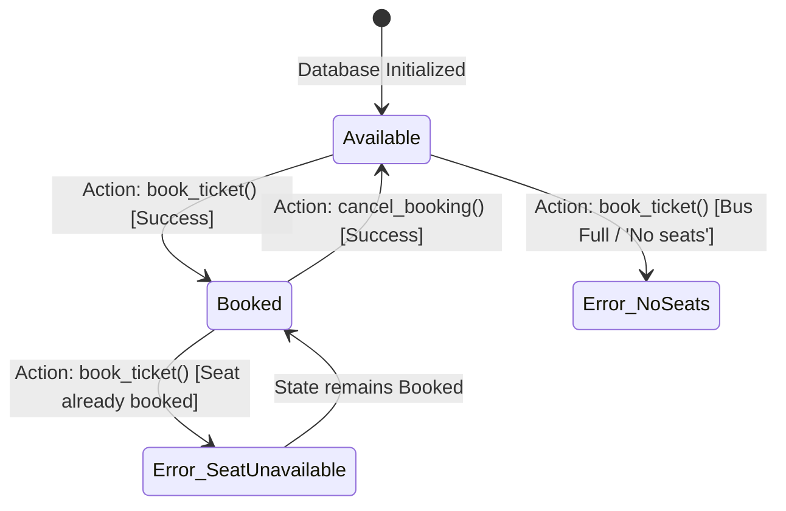

# Black Box Testing Specification & Test Cases
## Bus Reservation System — STQA Lab C2

**Testing Type:** Functional / Specification-Based (Black Box)  
**System Under Test (SUT):** Bus Reservation System  
**Framework:** Pytest 9.2.0 (`tests/test_black_box.py`)  

---

## 1. Overview of Black Box Testing Methodologies Applied

Black box testing evaluates the external functional behavior of the system without knowledge of its internal code structure or logic. The following techniques were systematically applied:

### 1.1 Equivalence Class Partitioning (ECP)
The input domain is partitioned into valid and invalid equivalence classes. Testing a single representative value from each class ensures broad coverage while eliminating redundant tests.

| Input Field | Valid Equivalence Classes (VEC) | Invalid Equivalence Classes (IEC) |
|---|---|---|
| **Passenger Name** | **VEC-1:** Alphabetic string (e.g., `"Alice"`). **VEC-2:** Alphanumeric with spaces (e.g., `"John Doe 2nd"`). | **IEC-1:** Empty string `""`. **IEC-2:** Whitespace-only `"   "`. **IEC-3:** `None` / Null value. |
| **Bus Route** | **VEC-3:** `"Bus 1"` (Valid 4-seat route). **VEC-4:** `"Bus 2"` (Valid 4-seat route). **VEC-5:** Case-insensitive match `"bus 1"`. | **IEC-4:** Non-existent bus `"Bus 99"`. **IEC-5:** Empty bus selection `""`. |
| **Seat Number** | **VEC-6:** Valid unassigned seat ID (`"A1"`, `"A2"`, `"B1"`). | **IEC-6:** Invalid seat format (`"Z9"`, `"A5"`). **IEC-7:** Full/exhausted token (`"No seats"`). **IEC-8:** Already reserved seat ID. |
| **Search Query** | **VEC-7:** Exact passenger name. **VEC-8:** Exact bus name. **VEC-9:** Case-insensitive query (`"ALICE"`). | **IEC-9:** Empty query `""`. **IEC-10:** Non-existent passenger/bus. |

---

### 1.2 Boundary Value Analysis (BVA)
BVA tests extreme values and boundaries of input variables and resource capacities.

- **Bus Capacity Boundary:**
  - Route Capacity $C = 4$.
  - Minimum boundary ($N=0$): All 4 seats available (`A1, A2, A3, A4`).
  - Nominal boundary ($N=1, 2, 3$): Progressive booking decrements available count.
  - Maximum boundary ($N=4$): Last seat booked, available count $= 0$.
  - Beyond boundary ($N=5$): Attempting to book when capacity $= 0$ triggers `SeatUnavailableError`.
- **String Length Boundary:**
  - Length $= 0$: Empty string $\to$ Rejected.
  - Length $= 1$: Single character `"A"` $\to$ Accepted.
  - Length $= 2$: Minimum typical name `"Al"` $\to$ Accepted.
  - Length $= 50$: Long string $\to$ Accepted and stored properly.

---

### 1.3 Decision Table Testing
A decision table evaluates complex business logic where multiple conditions determine the outcome.

| Condition / Action | Rule 1 | Rule 2 | Rule 3 | Rule 4 | Rule 5 |
|---|:---:|:---:|:---:|:---:|:---:|
| **Condition 1: Is Passenger Name Valid?** | **T** | **F** | **T** | **T** | **T** |
| **Condition 2: Is Bus Valid?** | **T** | **T** | **F** | **T** | **T** |
| **Condition 3: Is Selected Seat Available?** | **T** | **T** | **T** | **F** | **T** |
| **Condition 4: Does Passenger Have Prior Booking on Bus?** | **F** | **F** | **F** | **F** | **T** |
| **Action: Booking Confirmed (SUCCESS)** | **X** | | | | |
| **Action: Raise ValidationError** | | **X** | **X** | | |
| **Action: Raise SeatUnavailableError** | | | | **X** | |
| **Action: Raise DuplicateBookingError** | | | | | **X** |

---

### 1.4 State Transition Testing
Validates that seat entities transition between well-defined states according to system actions:

---

### 1.5 Error Guessing
Anticipating edge cases and anomalous user behaviors:
- Leading/trailing whitespace padding around names (`"  Alice Smith  "`).
- Mixed uppercase/lowercase strings in search and cancellation.
- Searching for blank strings or non-existent passengers.
- Cancelling non-existent records.

---

## 2. Comprehensive Black Box Test Cases Matrix

The following table documents the formal execution suite of Black Box test cases executed against the system:

| Test ID | Module / Component | Test Scenario | Test Steps | Input Data | Expected Result | Actual Result | Status |
|---|---|---|---|---|---|---|---|
| **TC_BB_001** | Booking Engine | Valid booking on Bus 1 | 1. Provide name 2. Select Bus 1 3. Select Seat A1 4. Submit | Name: `"John Doe"` Bus: `"Bus 1"` Seat: `"A1"` | Status: SUCCESS, booking ID assigned, seat A1 marked booked | Status: SUCCESS, ID: 1, seat booked | **PASS** |
| **TC_BB_002** | Booking Engine | Valid booking on Bus 2 | 1. Provide name 2. Select Bus 2 3. Select Seat B1 4. Submit | Name: `"Alice"` Bus: `"Bus 2"` Seat: `"B1"` | Status: SUCCESS, booking ID assigned, seat B1 marked booked | Status: SUCCESS, ID: 2, seat booked | **PASS** |
| **TC_BB_003** | Booking Engine | Alphanumeric passenger name | 1. Enter name with digits 2. Select route 3. Book seat | Name: `"Ravi Kumar 007"` Bus: `"Bus 2"` Seat: `"B2"` | Booking confirmed | Booking confirmed successfully | **PASS** |
| **TC_BB_004** | Booking Engine | Booking with whitespace-padded name | 1. Enter name with leading/trailing spaces 2. Book ticket | Name: `"   Robert Downey   "` Bus: `"Bus 1"` Seat: `"A1"` | Name trimmed to `"Robert Downey"`, booking confirmed | Name trimmed and booked successfully | **PASS** |
| **TC_BB_005** | Booking Engine | Rejection of empty name | 1. Leave name empty 2. Attempt booking | Name: `""` Bus: `"Bus 1"` Seat: `"A1"` | `ValidationError`: "Passenger name cannot be empty" | `ValidationError` raised with expected message | **PASS** |
| **TC_BB_006** | Booking Engine | Rejection of whitespace-only name | 1. Enter spaces as name 2. Attempt booking | Name: `"   "` Bus: `"Bus 1"` Seat: `"A1"` | `ValidationError`: "Passenger name cannot be empty" | `ValidationError` raised | **PASS** |
| **TC_BB_007** | Booking Engine | Rejection of unlisted bus route | 1. Enter valid name 2. Pass invalid bus identifier | Name: `"Valid User"` Bus: `"Bus 99"` Seat: `"A1"` | `ValidationError`: "Bus 'Bus 99' is not recognized" | `ValidationError` raised | **PASS** |
| **TC_BB_008** | Booking Engine | Rejection of invalid seat identifier | 1. Enter valid name & bus 2. Pass out-of-range seat | Name: `"Valid User"` Bus: `"Bus 1"` Seat: `"Z9"` | `ValidationError`: "Seat 'Z9' is not valid for Bus 1" | `ValidationError` raised | **PASS** |
| **TC_BB_009** | Capacity / BVA | Full capacity boundary test (4 seats) | 1. Book A1, A2, A3, A4 progressively on Bus 1 | Passengers: P1, P2, P3, P4 Seats: A1, A2, A3, A4 | Available seats decrement: 4 $\to$ 3 $\to$ 2 $\to$ 1 $\to$ 0 | Available seats correctly reach 0 | **PASS** |
| **TC_BB_010** | Capacity / BVA | Rejection on bus capacity overflow | 1. Attempt 5th booking when all 4 seats booked | Name: `"P5"` Bus: `"Bus 1"` Seat: `"No seats"` | `SeatUnavailableError` raised | `SeatUnavailableError` raised | **PASS** |
| **TC_BB_011** | Decision Table | Rejection of already booked seat | 1. Book seat A1 for Alice 2. Attempt booking A1 for Bob | Name: `"Bob"` Bus: `"Bus 1"` Seat: `"A1"` | `SeatUnavailableError`: "Seat 'A1' on Bus 1 is already booked" | `SeatUnavailableError` raised | **PASS** |
| **TC_BB_012** | Decision Table | Rejection of duplicate passenger on bus | 1. Book seat A1 for Alice 2. Attempt booking seat A2 for Alice | Name: `"Alice"` Bus: `"Bus 1"` Seat: `"A2"` | `DuplicateBookingError`: "Passenger already has a booking" | `DuplicateBookingError` raised | **PASS** |
| **TC_BB_013** | State Transition | Complete lifecycle: Book $\to$ Cancel $\to$ Re-book | 1. Book seat A1 2. Cancel seat A1 3. Verify A1 available 4. Re-book A1 | Name: `"Emma"` Bus: `"Bus 1"` Seat: `"A1"` | Seat transitions: Available $\to$ Booked $\to$ Available $\to$ Booked | All transitions verified successfully | **PASS** |
| **TC_BB_014** | Search Engine | Exact search by passenger name | 1. Search for existing passenger name | Query: `"Alice"` | 1 record returned with name "Alice", Bus 1, Seat A1 | Exactly 1 record returned | **PASS** |
| **TC_BB_015** | Search Engine | Case-insensitive passenger search | 1. Search with uppercase/lowercase permutations | Queries: `"ALICE"`, `"alice"`, `"AlIcE"` | All permutations return the matching record | Match found on all casing permutations | **PASS** |
| **TC_BB_016** | Search Engine | Search by bus route name | 1. Search query with bus identifier | Query: `"Bus 1"` | Returns all records booked on Bus 1 | Returns 2 records (Alice & Bob) | **PASS** |
| **TC_BB_017** | Search Engine | Search with empty query string | 1. Pass empty string to search | Query: `""` or `"   "` | Empty list `[]` returned, no crash | Returns `[]` | **PASS** |
| **TC_BB_018** | Cancellation | Valid cancellation with seat specified | 1. Pass valid passenger, bus, and seat | Name: `"Alice"`, Bus: `"Bus 1"`, Seat: `"A1"` | Status: CANCELLED, row removed from database | Record deleted, seat freed | **PASS** |
| **TC_BB_019** | Cancellation | Rejection on non-existent booking cancellation | 1. Attempt cancellation for unrecorded passenger | Name: `"Ghost"`, Bus: `"Bus 1"` | `BookingNotFoundError` raised | `BookingNotFoundError` raised | **PASS** |
| **TC_BB_020** | View Roster | Audit of all bookings in database | 1. Query all records | Seeded database with 3 bookings | Returns list of 3 dictionaries with id, name, bus, seat | Correctly returns 3 formatted records | **PASS** |
