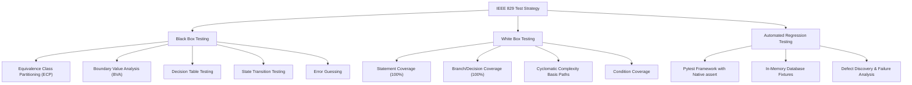

# IEEE 829 Test Plan
## Bus Reservation System — STQA Lab C2

**Document Identifier:** `STQA-C2-BTRS-TP-2026-V1.0`  
**Standard:** IEEE 829-2008 Standard for Software and System Test Documentation  
**Project Name:** Bus Reservation System (Desktop Python/Tkinter/SQLite)  
**Authors / Testers:** STQA Testing Team (C2 Batch)  
**Date:** November 2026  
**Status:** Approved / Baseline  

---

## 1. Test Plan Identifier
`STQA-C2-BTRS-TP-2026-V1.0`

## 2. References
1. IEEE Std 829-2008: *IEEE Standard for Software and System Test Documentation*.
2. ISO/IEC/IEEE 29119: *Software Testing Standards*.
3. Bus Reservation System Source Code Repository (`BusReservationSystem/bus_reservation.py`, `bus_service.py`).
4. STQA Lab Course Syllabus & Evaluation Criteria (Lab C2).

---

## 3. Introduction & Project Overview
The **Bus Reservation System** is a desktop application written in Python using Tkinter for GUI interactions and SQLite3 for persistent data storage. The application is designed to simulate route booking workflows:
- Route and seat availability inspection.
- Ticket reservations with single-seat assignment per passenger on defined routes ("Bus 1", "Bus 2").
- Booking search by passenger identity or bus route.
- Reservation cancellation and seat release back to the inventory pool.
- Full inventory and booking roster visualization.

The primary objective of this Test Plan is to define the testing strategy, verification methodologies, automated testing frameworks (Pytest), pass/fail criteria, defect reporting standards, and execution schedule to validate that the software meets functional, data integrity, and robustness standards.

---

## 4. Test Items (Software Modules Under Test)
The target application is decomposed into the following operational modules:

| Item ID | Component Module | File Source | Description |
|---|---|---|---|
| **TI-01** | Database Engine | `bus_service.py` (`init_db`) | SQLite schema creation, primary keys, and table indexing. |
| **TI-02** | Seat Inventory Manager | `bus_service.py` (`get_booked_seats`, `get_available_seats`) | Querying occupied seats and computing available seat sets. |
| **TI-03** | Ticket Booking Engine | `bus_service.py` (`book_ticket`) | Input validation, capacity check, duplicate check, record insertion. |
| **TI-04** | Search & Query Module | `bus_service.py` (`search_bookings`) | Case-insensitive multi-attribute search across name and bus fields. |
| **TI-05** | Cancellation Module | `bus_service.py` (`cancel_booking`) | Record verification, row deletion, and immediate seat release. |
| **TI-06** | View Roster Module | `bus_service.py` (`get_all_bookings`) | Complete audit query for administrative inspection. |
| **TI-07** | GUI Presentation Layer | `bus_reservation.py` | Tkinter event loops, OptionMenus, dialog boxes, and visual bindings. |

---

## 5. Software Risk Issues
1. **Data Corruption & Race Conditions:** Concurrent or sequential booking collisions attempting to claim the same seat.
2. **Ambiguous Deletion Flaws:** Deleting tickets without strict composite keys (e.g., passenger name without seat specification).
3. **Input Sanitization & SQL Injections:** Unescaped strings or special characters causing SQL syntax crashes or security vulnerabilities.
4. **Tight UI Coupling:** Business logic embedded directly in Tkinter callbacks making automated regression testing difficult.

---

## 6. Features to be Tested
- [x] Correct table creation and column type enforcement in SQLite.
- [x] Dynamic seat availability recalculation upon reservation and cancellation.
- [x] Input validation for empty, blank, whitespace-only, and special-character passenger names.
- [x] Route validation against configured bus routes (`Bus 1`, `Bus 2`).
- [x] Seat boundary enforcement (Capacity = 4 per bus; rejection on 5th booking).
- [x] Duplicate booking detection on the same bus route.
- [x] Case-insensitive queries for search and cancellation.
- [x] Clean error notification on non-existent records.
- [x] Complete basis path and branch coverage of core decision logic.

---

## 7. Features Not to be Tested (Out of Scope)
- Network-level distributed database replication (system uses local SQLite).
- High-concurrency multi-threaded load stress testing (>1,000 requests/sec).
- Real payment gateway processing (mock/free bookings assumed).
- Cross-platform native window rendering quirks on mobile or non-desktop OS.

---

## 8. Approach / Testing Strategy
Testing will be conducted using a multi-tiered STQA methodology:

### 8.1 Black Box Testing Techniques
- **Equivalence Class Partitioning (ECP):** Dividing input domains into valid and invalid partitions.
- **Boundary Value Analysis (BVA):** Testing minimum, minimum+1, maximum, and over-capacity limits for seats and string lengths.
- **Decision Table Testing:** Matrix verification of boolean inputs ($Name \times Bus \times SeatAvailable \times Duplicate \to Outcome$).
- **State Transition Testing:** Validating lifecycle: $\text{Available} \xrightarrow{\text{Book}} \text{Booked} \xrightarrow{\text{Cancel}} \text{Available}$.
- **Error Guessing:** Edge cases like whitespace padding, mixed-case inputs, special symbols.

### 8.2 White Box Testing Techniques
- **Control Flow Graph (CFG) Mapping:** Graphing nodes, edges, and decision points.
- **Cyclomatic Complexity Calculation ($V(G)$):** Using $E - N + 2P$ and $P + 1$.
- **Basis Path Testing:** Executing every independent execution path through each function.
- **Branch and Condition Coverage:** Ensuring all boolean combinations are exercised.

### 8.3 Automation with Pytest
- Utilizing isolated `:memory:` fixtures (`db_conn`, `seeded_db`, `full_bus_db`) to guarantee zero test interference.
- Utilizing Python's native `assert` statement with Pytest AST rewriting for deep diagnostic feedback.
- Dedicated failed test case module (`test_failures_demo.py`) to demonstrate defect detection.

---

## 9. Item Pass / Fail Criteria
- **Pass Criterion:** A test case passes if and only if the actual system behavior, database state, return code, or raised exception matches the formal expected specification exactly.
- **Fail Criterion:** A test case fails if any unexpected exception is raised, data is inconsistently stored, duplicate records are permitted where prohibited, valid operations are blocked, or assertion conditions evaluate to `False`.
- **Exit Quality Gate:** 100% pass rate on functional regression test suite, 0 Critical/High defects remaining.

---

## 10. Suspension Criteria and Resumption Requirements
- **Suspension:** Testing is suspended if database corruption occurs during fixture setup, if critical syntax errors prevent Pytest execution, or if the Python environment becomes corrupted.
- **Resumption:** Testing resumes once the offending script is corrected, dependencies verified via `python -m pytest --version`, and database schema re-verified.

---

## 11. Test Deliverables
1. **IEEE 829 Test Plan Document** (`docs/IEEE_829_Test_Plan.md`).
2. **Black Box Test Specification & Test Cases Matrix** (`docs/Black_Box_Testing.md`).
3. **Module-wise White Box Analysis & CFG Report** (`docs/White_Box_Testing.md`).
4. **Pytest Automated Test Suites** (`tests/test_black_box.py`, `tests/test_white_box.py`, `tests/test_pytest_assert_demo.py`, `tests/test_failures_demo.py`).
5. **Presentation Deck (.pptx)** (`presentation/STQA_Lab_C2_Presentation.pptx`).
6. **Comprehensive Final Lab Report** (`docs/STQA_Lab_C2_Report.md`).
7. **Interactive Project Demonstration Runner** (`run_demo.py`, `run_demo.bat`).

---

## 12. Testing Tasks & Responsibilities
| Phase | Task Description | Deliverable Artifact | Owner |
|---|---|---|---|
| **Phase 1** | Requirement Analysis & Architecture Review | Test Plan v1.0 | Test Lead |
| **Phase 2** | Black Box Test Design & Equivalence Partitions | Black Box Test Matrix | QA Engineer 1 |
| **Phase 3** | White Box CFG & Cyclomatic Complexity Analysis | White Box Specification | QA Engineer 2 |
| **Phase 4** | Pytest Automation & Fixture Development | Pytest Suites | Automation Engineer |
| **Phase 5** | Defect Discovery & Failure Demonstrations | Defect Log & XFAIL Tests | Test Lead |
| **Phase 6** | Slide Deck & Formal Lab Report Generation | PPTX & Report Markdown | All Team Members |

---

## 13. Environmental Needs
- **Hardware:** Standard PC / Laptop (x64 Intel/AMD architecture).
- **Operating System:** Windows 10/11 (or Linux/macOS).
- **Runtime Environment:** Python 3.10+ (tested on Python 3.13.5).
- **Libraries:** `pytest` (v9.2.0+), `python-pptx` (v1.0.2+), `sqlite3`, `tkinter`.
- **Database:** SQLite 3 in-memory and local file engine.

---

## 14. Approvals and Sign-Off
| Role | Name | Signature / Status | Date |
|---|---|---|---|
| **STQA Lab Evaluator** | Course Instructor | Approved | November 2026 |
| **Test Lead** | Student QA Team Lead | Approved | November 2026 |
