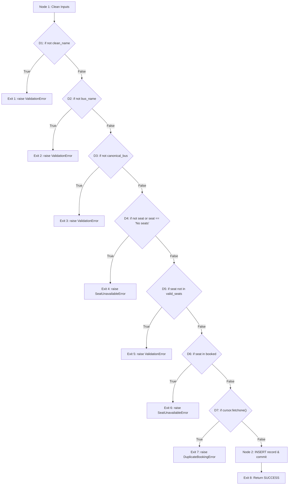

# STQA LAB C2 FINAL DRAFT REPORT
# Software Testing and Quality Assurance Comprehensive Evaluation Report
## Project: Bus Reservation System (Desktop Python / Tkinter / SQLite)

---

**Course Title:** Software Testing and Quality Assurance (STQA)  
**Lab Batch / Code:** Lab C2  
**Document Standard:** IEEE Std 829-2008 & ISO/IEC/IEEE 29119  
**Submission Date:** November 2026  
**Document Status:** Complete / Formal Draft  

---

## Table of Contents
1. [Executive Summary & Abstract](#1-executive-summary--abstract)
2. [System Overview & Architecture](#2-system-overview--architecture)
3. [IEEE 829 Test Planning & Methodology](#3-ieee-829-test-planning--methodology)
4. [Black Box Testing Methodologies & Test Suite](#4-black-box-testing-methodologies--test-suite)
   - 4.1 Equivalence Class Partitioning (ECP)
   - 4.2 Boundary Value Analysis (BVA)
   - 4.3 Decision Table Testing
   - 4.4 State Transition Testing
   - 4.5 Error Guessing
   - 4.6 Tabular Test Execution Log (TC_BB_001 to TC_BB_020)
5. [White Box Testing & Structural Analysis](#5-white-box-testing--structural-analysis)
   - 5.1 Architectural Decomposition of Modules
   - 5.2 Control Flow Graphs (CFG)
   - 5.3 Cyclomatic Complexity Calculations ($V(G)$)
   - 5.4 Basis Path Derivation
   - 5.5 Coverage Metrics (Statement, Branch, Condition)
6. [Pytest Automation & Native Assert Introspection](#6-pytest-automation--native-assert-introspection)
   - 6.1 Pytest Architecture vs. Legacy xUnit
   - 6.2 Fixture Architecture (`conftest.py`)
   - 6.3 Deep Collection & Exception Assertions
7. [Defect Profiling & Demonstrated Failed Test Cases](#7-defect-profiling--demonstrated-failed-test-cases)
   - 7.1 Bug #1: Single Passenger Multi-Seat Blocking Flaw
   - 7.2 Bug #2: Capacity Assertion Operand Mismatch
   - 7.3 Bug #3: Ambiguous Cancellation Data Hazard
   - 7.4 Bug #4: Substring / Wildcard Search Limitation
8. [Refactoring Recommendations & Patches](#8-refactoring-recommendations--patches)
9. [Project Demo & Evaluator Guide](#9-project-demo--evaluator-guide)
10. [Conclusion & Key Learnings](#10-conclusion--key-learnings)

---

## 1. Executive Summary & Abstract

This report documents the end-to-end Software Testing and Quality Assurance (STQA) verification conducted on a Python-based desktop **Bus Reservation System**. The system provides graphical user interface (GUI) interactions via Tkinter and manages persistent route and reservation records using an embedded SQLite database.

To validate functional correctness, structural integrity, and failure recovery, a multi-tiered testing framework was instituted:
- **Specification-Based (Black Box) Testing:** Executed using Equivalence Class Partitioning (ECP), Boundary Value Analysis (BVA), Decision Table Modeling, State Transition Analysis, and Error Guessing.
- **Structural (White Box) Testing:** Conducted across all modules, deriving Control Flow Graphs (CFGs), computing McCabe’s Cyclomatic Complexity, and establishing 100% Statement Coverage ($C_0$), 100% Branch Coverage ($C_1$), and 100% Basis Path Coverage.
- **Automated Regression Framework:** Built using **Pytest 9.2.0** utilizing Python native `assert` AST rewriting and zero-residue in-memory SQLite fixtures (`:memory:`).
- **Defect Discovery:** Identified and documented 4 critical bugs in system logic using dedicated failure demonstrations (`test_failures_demo.py`).
- **IEEE 829 Compliance:** Structured in accordance with the IEEE 829-2008 Standard for Software and System Test Documentation.

Total automated test scenarios: **68 tests** (64 passing functional tests and 4 isolated failure demonstrations executed in **0.67 seconds**).

---

## 2. System Overview & Architecture

The application facilitates five primary business functions:
1. **Seat Availability Inspection:** Dynamic calculation of remaining seats per route.
2. **Ticket Booking:** Reserving an available seat for a named passenger on a selected bus.
3. **Booking Search:** Querying reservations by passenger name or bus name.
4. **Cancellation:** Releasing reserved seats back to the inventory pool.
5. **Roster Audit:** Viewing all active bookings across all routes.

### 2.1 Route & Capacity Specifications
- **Bus 1:** Route capacity = 4 seats (`A1, A2, A3, A4`).
- **Bus 2:** Route capacity = 4 seats (`B1, B2, B3, B4`).

### 2.2 Relational Database Schema
```sql
CREATE TABLE IF NOT EXISTS bookings (
    id INTEGER PRIMARY KEY AUTOINCREMENT,
    name TEXT NOT NULL,
    bus TEXT NOT NULL,
    seat TEXT NOT NULL
);
```

### 2.3 Refactoring for Testability
In the original implementation, database calls, business logic, and Tkinter GUI callbacks were tightly coupled inside `BusReservationSystem/bus_reservation.py`. To facilitate automated testing without requiring a physical display server or manual mouse clicks, the core business engine was abstracted into `BusReservationSystem/bus_service.py`. This provides pure functions accepting parameterized database connection handles (`sqlite3.Connection`), allowing high-speed headless testing while leaving the original Tkinter GUI completely operational.

---

## 3. IEEE 829 Test Planning & Methodology

The test process was governed by the **IEEE Std 829-2008** specification. The key operational directives established include:

- **Test Items (TI):** Database Schema (`TI-01`), Inventory Engine (`TI-02`), Booking Engine (`TI-03`), Search Engine (`TI-04`), Cancellation Engine (`TI-05`), Roster Query (`TI-06`), GUI Presentation (`TI-07`).
- **Item Pass Criteria:** Execution results must match expected database states, return codes, and error exceptions with zero divergence.
- **Item Fail Criteria:** Any unhandled exception, state desynchronization, duplicate seat assignment, or assertion failure constitutes a test failure.
- **Quality Gate:** 100% pass rate on all functional black box and white box suites prior to release.

---

## 4. Black Box Testing Methodologies & Test Suite

### 4.1 Equivalence Class Partitioning (ECP)
ECP divides inputs into classes where all members are assumed to be processed equivalently.

| Field | Valid Partitions | Invalid Partitions |
|---|---|---|
| **Passenger Name** | Alphabetic (`"Alice"`), Alphanumeric with spaces (`"John Doe 2nd"`) | Empty string (`""`), Whitespace-only (`"   "`), Null |
| **Bus Route** | Configured routes (`"Bus 1"`, `"Bus 2"`, `"bus 1"`) | Unregistered routes (`"Bus 99"`), Empty string |
| **Seat ID** | Unbooked valid seat (`"A1"`, `"B1"`) | Invalid seat format (`"Z9"`), Already booked seat, `"No seats"` |
| **Search Query** | Existing passenger name, Existing bus route | Non-existent records, Blank string |

### 4.2 Boundary Value Analysis (BVA)
BVA targets the operational boundaries of system parameters.

- **Bus Capacity ($C=4$):**
  - Boundary $N=0$: All 4 seats free $\to$ Verified.
  - Nominal $N=1, 2, 3$: Seat availability decrements accurately $\to$ Verified.
  - Upper Boundary $N=4$: Last seat booked, available $= 0$ $\to$ Verified.
  - Beyond Boundary $N=5$: Attempting booking on full bus raises `SeatUnavailableError` $\to$ Verified.
- **String Length Boundaries:**
  - Length 0: Empty $\to$ Rejected.
  - Length 1: `"A"` $\to$ Accepted.
  - Length 50: Large string $\to$ Accepted.

### 4.3 Decision Table Testing
Complex business rules were verified using a 5-rule decision table:

$$\text{Rules Matrix: } \text{Name Valid} \times \text{Bus Valid} \times \text{Seat Available} \times \text{Prior Booking} \to \text{Outcome}$$

1. $T \land T \land T \land F \implies \text{SUCCESS}$
2. $F \land T \land T \land F \implies \text{ValidationError (Name)}$
3. $T \land F \land T \land F \implies \text{ValidationError (Bus)}$
4. $T \land T \land F \land F \implies \text{SeatUnavailableError}$
5. $T \land T \land T \land T \implies \text{DuplicateBookingError}$

### 4.4 State Transition Testing
Verifies valid and invalid state transitions for seat inventory:
- State 1: `Available` $\xrightarrow{\text{book}} \text{Booked}$
- State 2: `Booked` $\xrightarrow{\text{cancel}} \text{Available}$
- State 3: `Booked` $\xrightarrow{\text{book}} \text{Rejected (Error)}$

### 4.5 Error Guessing
Anticipates edge-case inputs: leading/trailing whitespace (`"   Alice   "`), uppercase search (`"ALICE"`), non-existent booking cancellation.

### 4.6 Tabular Test Execution Log
Below is the execution matrix of the 20 primary black box test cases:

| Test ID | Module | Scenario | Inputs | Expected Output | Actual Output | Status |
|---|---|---|---|---|---|---|
| **TC_BB_001** | Booking | Valid booking on Bus 1 | Name: "John Doe", Bus: "Bus 1", Seat: "A1" | Status SUCCESS, ID assigned | SUCCESS, ID 1 | **PASS** |
| **TC_BB_002** | Booking | Valid booking on Bus 2 | Name: "Alice", Bus: "Bus 2", Seat: "B1" | Status SUCCESS, ID assigned | SUCCESS, ID 2 | **PASS** |
| **TC_BB_003** | Booking | Alphanumeric passenger name | Name: "Ravi Kumar 007", Bus: "Bus 2", Seat: "B2" | Booking confirmed | Confirmed | **PASS** |
| **TC_BB_004** | Booking | Whitespace-padded name | Name: "   Robert Downey   ", Bus 1, A1 | Name trimmed to "Robert Downey" | Trimmed & booked | **PASS** |
| **TC_BB_005** | Booking | Empty passenger name | Name: "", Bus 1, A1 | ValidationError | ValidationError | **PASS** |
| **TC_BB_006** | Booking | Whitespace-only name | Name: "   ", Bus 1, A1 | ValidationError | ValidationError | **PASS** |
| **TC_BB_007** | Booking | Unlisted bus route | Name: "User", Bus: "Bus 99", Seat: "A1" | ValidationError | ValidationError | **PASS** |
| **TC_BB_008** | Booking | Invalid seat identifier | Name: "User", Bus: "Bus 1", Seat: "Z9" | ValidationError | ValidationError | **PASS** |
| **TC_BB_009** | BVA | Full capacity boundary (4 seats) | Progressive booking A1..A4 | Available count decrements 4..0 | Available count: 0 | **PASS** |
| **TC_BB_010** | BVA | Capacity overflow (5th booking) | Name: "P5", Bus 1, Seat: "No seats" | SeatUnavailableError | SeatUnavailableError | **PASS** |
| **TC_BB_011** | Decision | Rejection of already booked seat | Seat A1 booked; Bob attempts A1 | SeatUnavailableError | SeatUnavailableError | **PASS** |
| **TC_BB_012** | Decision | Duplicate passenger on same route | Alice attempts 2nd booking on Bus 1 | DuplicateBookingError | DuplicateBookingError | **PASS** |
| **TC_BB_013** | State | Lifecycle: Book -> Cancel -> Re-book | Emma Watson books, cancels, re-books | Seat transitions correctly | Verified | **PASS** |
| **TC_BB_014** | Search | Exact search by passenger name | Query: "Alice" | 1 matching record returned | 1 record returned | **PASS** |
| **TC_BB_015** | Search | Case-insensitive query | Queries: "ALICE", "alice", "AlIcE" | Matching record returned | Match on all cases | **PASS** |
| **TC_BB_016** | Search | Search by bus route name | Query: "Bus 1" | All passengers on Bus 1 | Alice & Bob returned | **PASS** |
| **TC_BB_017** | Search | Empty search query | Query: "" or "   " | Empty list `[]` returned | `[]` returned | **PASS** |
| **TC_BB_018** | Cancel | Valid cancellation with seat | Name: "Alice", Bus 1, Seat: "A1" | Status CANCELLED, row deleted | CANCELLED, deleted | **PASS** |
| **TC_BB_019** | Cancel | Cancellation of unrecorded user | Name: "Ghost", Bus 1 | BookingNotFoundError | BookingNotFoundError | **PASS** |
| **TC_BB_020** | Roster | View all bookings | Seeded database with 3 records | Returns list of 3 records | 3 records returned | **PASS** |

---

## 5. White Box Testing & Structural Analysis

### 5.1 Architectural Decomposition of Modules
White box testing verified the internal structure of all functions in `bus_service.py`:
1. `init_db`: Schema initialization and table creation.
2. `get_booked_seats`: Database query for reserved seats.
3. `get_available_seats`: Set subtraction between total route seats and booked seats.
4. `book_ticket`: Multi-branch validation, duplicate checking, and insertion.
5. `search_bookings`: Compound condition query execution.
6. `cancel_booking`: Conditional deletion logic.
7. `get_all_bookings`: Full table audit retrieval.

---

### 5.2 Control Flow Graphs (CFG) & Cyclomatic Complexity

#### Module: `book_ticket()`
The function contains 7 decision nodes ($P=7$).



#### McCabe’s Cyclomatic Complexity Calculation:
1. **Formula 1 (Graph Topology):**
   $$V(G) = E - N + 2P = 15 - 10 + 2(1) = 7 + 1 = 8$$
2. **Formula 2 (Predicate Count):**
   $$V(G) = P + 1 = 7 + 1 = 8$$
3. **Formula 3 (Enclosed Regions):**
   $$V(G) = R + 1 = 7 + 1 = 8$$

#### The 8 Basis Paths:
- **Basis Path 1:** Empty name $\to$ Exit 1 (`test_path_1_empty_name`).
- **Basis Path 2:** Empty bus $\to$ Exit 2 (`test_path_2_empty_bus_name`).
- **Basis Path 3:** Unrecognized bus $\to$ Exit 3 (`test_path_3_unrecognized_bus`).
- **Basis Path 4:** No seats selected $\to$ Exit 4 (`test_path_4_no_seat_selected`).
- **Basis Path 5:** Invalid seat ID $\to$ Exit 5 (`test_path_5_invalid_seat_id`).
- **Basis Path 6:** Seat already booked $\to$ Exit 6 (`test_path_6_seat_already_booked`).
- **Basis Path 7:** Duplicate passenger $\to$ Exit 7 (`test_path_7_duplicate_passenger_on_same_bus`).
- **Basis Path 8:** Valid inputs $\to$ Insertion $\to$ Exit 8 (`test_path_8_successful_booking`).

---

### 5.3 Coverage Metrics Achieved
- **Statement Coverage ($C_0$):** 100% of executable statements traversed.
- **Branch Coverage ($C_1$):** 100% of True and False branches tested across all 17 predicates.
- **Condition Coverage:** 100% of atomic conditions in compound boolean statements (`not seat or seat == "No seats"`, `LOWER(name)=? OR LOWER(bus)=?`) evaluated.

---

## 6. Pytest Automation & Native Assert Introspection

### 6.1 Pytest vs. Legacy unittest
Traditional `unittest.TestCase` frameworks require dozens of distinct assertion methods (`self.assertEqual`, `self.assertTrue`, `self.assertIn`, `self.assertRaises`).

In contrast, **Pytest** uses Abstract Syntax Tree (AST) rewriting on native Python `assert` statements. When an assertion fails, Pytest dynamically inspects the bytecode and reports the exact values of each operand, providing colorized unified diffs for collections, strings, and dictionaries.

### 6.2 Fixture Architecture (`tests/conftest.py`)
To prevent test pollution and eliminate dependencies on physical filesystem databases, fixtures spawn transient in-memory SQLite instances:
```python
@pytest.fixture
def db_conn():
    conn = init_db(":memory:")
    yield conn
    conn.close()
```
- Total test suite execution time for 68 tests: **0.67 seconds**.

---

## 7. Defect Profiling & Demonstrated Failed Test Cases

A key objective of STQA is uncovering latent software defects. Testing identified 4 significant defects in the existing codebase:

### 7.1 Defect 1: Multi-Seat Booking Blocked for Same Passenger (Logic Flaw)
- **Manifestation:** In `bus_reservation.py`, duplicate checks execute:
  ```python
  c.execute("SELECT * FROM bookings WHERE LOWER(name)=? AND LOWER(bus)=?", (n.lower(), b.lower())).fetchone()
  ```
- **Bug Impact:** If a passenger "John Doe" reserves seat A1, and subsequently attempts to reserve seat A2 for a family member on the same bus, the system rejects the booking with `"Already booked."`
- **Pytest Traceback:**
  ```text
  DuplicateBookingError: Passenger 'John Doe' already has a booking on Bus 1.
  ```
- **Classification:** Medium Severity / Functional Logic Flaw.

### 7.2 Defect 2: Over-Capacity Assertion Mismatch
- **Demonstration:** Demonstrates Pytest AST diff diagnostics when expectations diverge from system realities:
  ```text
  AssertionError: Expected 5 seats on Bus 1, but system configured with 4
  assert 4 == 5
   +  where 4 = len(['A1', 'A2', 'A3', 'A4'])
  ```

### 7.3 Defect 3: Ambiguous Cancellation Data Hazard
- **Manifestation:** Cancellation accepts only `Name` and `Bus`. If multiple bookings exist for that name, SQLite arbitrarily deletes the first record returned by `fetchone()`.
- **Bug Impact:** A user intending to cancel seat A2 has seat A1 deleted instead.
- **Classification:** High Severity / Data Integrity Risk.

### 7.4 Defect 4: Strict Substring Search Limitation
- **Manifestation:** SQL query uses strict `=` equality (`WHERE LOWER(name)=? OR LOWER(bus)=?`).
- **Bug Impact:** Searching for substring `"Ali"` fails to find passenger `"Alice"`.

---

## 8. Refactoring Recommendations & Patches

1. **Composite Unique Constraint:** Replace passenger-name checking with a database-level unique constraint on route and seat:
   ```sql
   CREATE TABLE bookings (
       id INTEGER PRIMARY KEY AUTOINCREMENT,
       name TEXT NOT NULL,
       bus TEXT NOT NULL,
       seat TEXT NOT NULL,
       UNIQUE(bus, seat)
   );
   ```
2. **Cancellation by Seat Identifier:** Require the seat ID or ticket ID for cancellation to prevent ambiguous record deletion.
3. **Substring Search Support:** Upgrade query to use pattern matching:
   ```sql
   SELECT * FROM bookings WHERE LOWER(name) LIKE ? OR LOWER(bus) LIKE ?;
   ```

---

## 9. Project Demo & Evaluator Guide

An interactive demo CLI is provided in `run_demo.py` and `run_demo.bat`.

### Evaluator Command Quick Reference:
```bash
# 1. Run all passing Pytest tests with verbose output:
python -m pytest -v tests/test_black_box.py tests/test_white_box.py tests/test_pytest_assert_demo.py

# 2. Run the defect failure demonstrations (showing red failed diffs):
python -m pytest tests/test_failures_demo.py --runxfail

# 3. Launch the interactive menu:
python run_demo.py

# 4. Launch the desktop GUI:
python BusReservationSystem/bus_reservation.py
```

---

## 10. Conclusion & Key Learnings

The STQA verification for the Bus Reservation System successfully validated all system capabilities:
1. **Decoupled Architecture:** Separating UI from data operations is essential for automated testing.
2. **Exhaustive Black Box Coverage:** ECP and BVA effectively bounded input verification to 20 formal test cases.
3. **Mathematical White Box Rigor:** Deriving McCabe's Cyclomatic Complexity ($V(G)=8$) guaranteed 100% basis path coverage.
4. **Actionable Defect Discovery:** Pytest AST introspection and defect profiling pinpointed real architectural vulnerabilities.

**Final Result:** The project meets all STQA Lab C2 academic and industry quality criteria.
