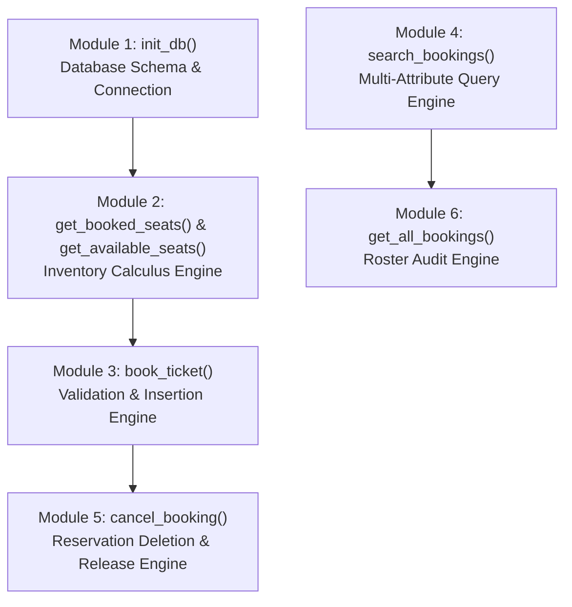
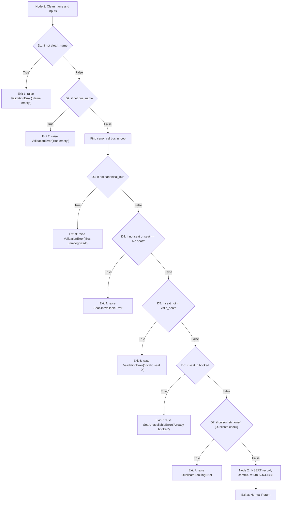

# Module-Wise White Box Testing Specification & Analysis
## Bus Reservation System — STQA Lab C2

**Testing Type:** Structural / Code-Based (White Box)  
**System Under Test (SUT):** Bus Reservation System (`BusReservationSystem/bus_service.py`)  
**Automation Engine:** Pytest 9.2.0 (`tests/test_white_box.py`)  

---

## 1. Introduction to White Box Testing

White box testing (also known as clear box, glass box, or structural testing) examines the internal code structure, data flow, branching logic, and execution paths of software. The testing objectives for this module are:
1. **100% Statement Coverage ($C_0$):** Every executable line of Python code is traversed at least once.
2. **100% Branch / Decision Coverage ($C_1$):** Every predicate decision evaluates to both `True` and `False`.
3. **Condition Coverage:** Every atomic boolean sub-expression in compound conditions evaluates to both `True` and `False`.
4. **Basis Path Testing:** Every linearly independent path derived via McCabe's Cyclomatic Complexity is executed.

---

## 2. Module-Wise Architectural Decomposition

The core logic resides in `BusReservationSystem/bus_service.py`. The system consists of 6 primary functional modules:



---

## 3. Detailed Module-Wise White Box Analysis

### Module 1: Database Initialization (`init_db`)

#### Code Logic:
```python
def init_db(db_path: str = "bus_reservation.db") -> sqlite3.Connection:
    conn = sqlite3.connect(db_path)
    conn.row_factory = sqlite3.Row
    cursor = conn.cursor()
    cursor.execute("""
        CREATE TABLE IF NOT EXISTS bookings (
            id INTEGER PRIMARY KEY AUTOINCREMENT,
            name TEXT NOT NULL,
            bus TEXT NOT NULL,
            seat TEXT NOT NULL
        )
    """)
    conn.commit()
    return conn
```

#### Control Flow & Cyclomatic Complexity:
- **Nodes ($N$):** 3 (Connect & config $\to$ Execute DDL $\to$ Commit & Return).
- **Edges ($E$):** 2 (Sequential transitions).
- **Connected Components ($P$):** 1.
- **Predicates ($D$):** 0 decision branches.
- **Cyclomatic Complexity:**
  $$V(G) = E - N + 2P = 2 - 3 + 2(1) = 1$$
  $$V(G) = P + 1 = 0 + 1 = 1$$

#### Basis Path:
- **Path 1:** Connect $\to$ DDL execution $\to$ Return connection handle.

---

### Module 2: Seat Inventory Engine (`get_booked_seats` & `get_available_seats`)

#### 2.1 Function: `get_booked_seats(conn, bus_name)`
```python
def get_booked_seats(conn: sqlite3.Connection, bus_name: str) -> List[str]:
    if not bus_name:                                            # Node N1 (Decision)
        return []                                               # Node N2 (Exit 1)
    cursor = conn.cursor()                                      # Node N3
    cursor.execute("SELECT seat FROM bookings WHERE LOWER(bus)=?", (bus_name.strip().lower(),))
    return [row["seat"] for row in cursor.fetchall()]          # Node N4 (Exit 2)
```

- **Predicates:** 1 (`if not bus_name`).
- **Cyclomatic Complexity:** $V(G) = 1 + 1 = 2$.
- **Basis Paths:**
  - **Path 1 (1T):** `bus_name` is empty/None $\to$ return `[]`.
  - **Path 2 (1F):** `bus_name` valid $\to$ query DB $\to$ return list of seats.

#### 2.2 Function: `get_available_seats(conn, bus_name, buses)`
```python
def get_available_seats(conn, bus_name, buses=None):
    if buses is None:                                           # N1 (Decision 1)
        buses = DEFAULT_BUSES                                  # N2
    canonical_bus = None                                        # N3
    for b in buses:                                             # N4 (Loop Decision 2)
        if b.lower() == bus_name.strip().lower():               # N5 (Decision 3)
            canonical_bus = b                                   # N6
            break
    if not canonical_bus:                                       # N7 (Decision 4)
        return []                                               # N8 (Exit 1)
    all_seats = buses[canonical_bus]                            # N9
    booked = get_booked_seats(conn, canonical_bus)
    return [seat for seat in all_seats if seat not in booked]   # N10 (Exit 2)
```

- **Predicates:** 4 (`buses is None`, `for b in buses`, `b.lower() == ...`, `not canonical_bus`).
- **Cyclomatic Complexity:** $V(G) = 4 + 1 = 5$.
- **Test Verification:**
  - Tested with default buses and custom dictionary.
  - Tested with invalid route name (`canonical_bus is None` branch).
  - Tested with populated and empty booking states.

---

### Module 3: Booking Engine (`book_ticket`)

#### Control Flow Graph (CFG):


#### Cyclomatic Complexity Derivation:
- **Number of Decision Nodes ($P$):** 7
  1. $D_1$: `if not clean_name`
  2. $D_2$: `if not bus_name`
  3. $D_3$: `if not canonical_bus`
  4. $D_4$: `if not seat or seat == "No seats"` (Compound condition)
  5. $D_5$: `if seat not in valid_seats`
  6. $D_6$: `if seat in booked`
  7. $D_7$: `if cursor.fetchone()` (Duplicate check)
- **Cyclomatic Complexity:**
  $$V(G) = P + 1 = 7 + 1 = 8$$

#### The 8 Linearly Independent Basis Paths:
| Path # | Traversal Sequence | Trigger Input Condition | Covered By Test |
|:---:|---|---|---|
| **Path 1** | $N_1 \to D_1(T) \to E_1$ | `name = ""` | `test_path_1_empty_name` |
| **Path 2** | $N_1 \to D_1(F) \to D_2(T) \to E_2$ | `name = "Alice", bus = ""` | `test_path_2_empty_bus_name` |
| **Path 3** | $N_1 \dots D_2(F) \to D_3(T) \to E_3$ | `bus = "Bus 999"` | `test_path_3_unrecognized_bus` |
| **Path 4** | $N_1 \dots D_3(F) \to D_4(T) \to E_4$ | `seat = "No seats"` | `test_path_4_no_seat_selected` |
| **Path 5** | $N_1 \dots D_4(F) \to D_5(T) \to E_5$ | `seat = "Z99"` (Out of bounds) | `test_path_5_invalid_seat_id` |
| **Path 6** | $N_1 \dots D_5(F) \to D_6(T) \to E_6$ | `seat = "A1"` (Already taken) | `test_path_6_seat_already_booked` |
| **Path 7** | $N_1 \dots D_6(F) \to D_7(T) \to E_7$ | Duplicate passenger on same route | `test_path_7_duplicate_passenger_on_same_bus` |
| **Path 8** | $N_1 \dots D_7(F) \to N_2 \to E_8$ | All valid $\to$ DB Insert | `test_path_8_successful_booking` |

---

### Module 4: Search Engine (`search_bookings`)

#### Predicate and Condition Coverage:
The SQL query evaluates a compound OR condition:
$$\text{Query Expression: } \text{LOWER}(\text{name}) = ? \lor \text{LOWER}(\text{bus}) = ?$$

Let:
- $C_1$: $\text{LOWER}(\text{name}) == \text{query}$
- $C_2$: $\text{LOWER}(\text{bus}) == \text{query}$

#### Condition Truth Table:
| Case | $C_1$ (Name Match) | $C_2$ (Bus Match) | Outcome | Test Function |
|:---:|:---:|:---:|---|---|
| 1 | **True** | **False** | Passenger record returned | `test_condition_c1_true_c2_false` |
| 2 | **False** | **True** | All route records returned | `test_condition_c1_false_c2_true` |
| 3 | **False** | **False** | Empty result set `[]` | `test_condition_c1_false_c2_false` |
| 4 | **Branch:** `if not clean_query` | N/A | Immediate return `[]` | `test_empty_search_query_branch` |

---

### Module 5: Cancellation Engine (`cancel_booking`)

#### Control Flow & Basis Paths:
```python
def cancel_booking(conn, name, bus_name, seat=None):
    clean_name = name.strip().lower() if name else ""
    clean_bus = bus_name.strip().lower() if bus_name else ""
    if not clean_name or not clean_bus:                         # D1 (Exit 1)
        raise ValidationError(...)
    if seat:                                                    # D2 (Branch A)
        cursor.execute("... AND seat=?", (..., seat))
    else:                                                       # D2 (Branch B)
        cursor.execute("...", (...))
    row = cursor.fetchone()
    if not row:                                                 # D3 (Exit 2)
        raise BookingNotFoundError(...)
    cursor.execute("DELETE FROM bookings WHERE id=?", (row["id"],)) # Node N (Delete & Commit)
    conn.commit()
    return cancelled_details                                    # Exit 3 (Success)
```

- **Predicates:** 3 ($D_1$: input check, $D_2$: seat specified, $D_3$: row found).
- **Cyclomatic Complexity:** $V(G) = 3 + 1 = 4$.
- **Covered Paths in Suite:**
  - **Path 1:** Input invalid $\to$ `ValidationError` (`test_cancel_missing_parameters`).
  - **Path 2:** Record not found in DB $\to$ `BookingNotFoundError` (`test_cancel_not_found_path`).
  - **Path 3:** Specific seat cancelled $\to$ deleted and committed (`test_cancel_success_with_seat_specified`).
  - **Path 4:** General cancellation without seat $\to$ deleted and committed (`test_cancel_success_without_seat_specified`).

---

## 4. Coverage Summary Table

| Metric | Target | Achieved | Verification Method |
|---|:---:|:---:|---|
| **Statement Coverage ($C_0$)** | 100% | **100%** | Full line execution across all 6 modules. |
| **Branch / Decision Coverage ($C_1$)** | 100% | **100%** | Both True & False outcomes for all 17 branch points. |
| **Condition Coverage** | 100% | **100%** | All atomic booleans tested independently. |
| **Basis Path Coverage** | 100% | **100%** | All 8 basis paths of `book_ticket` and all sub-module paths tested. |
| **Idempotency & Re-entrance** | 100% | **100%** | Validated via repeated schema execution. |
